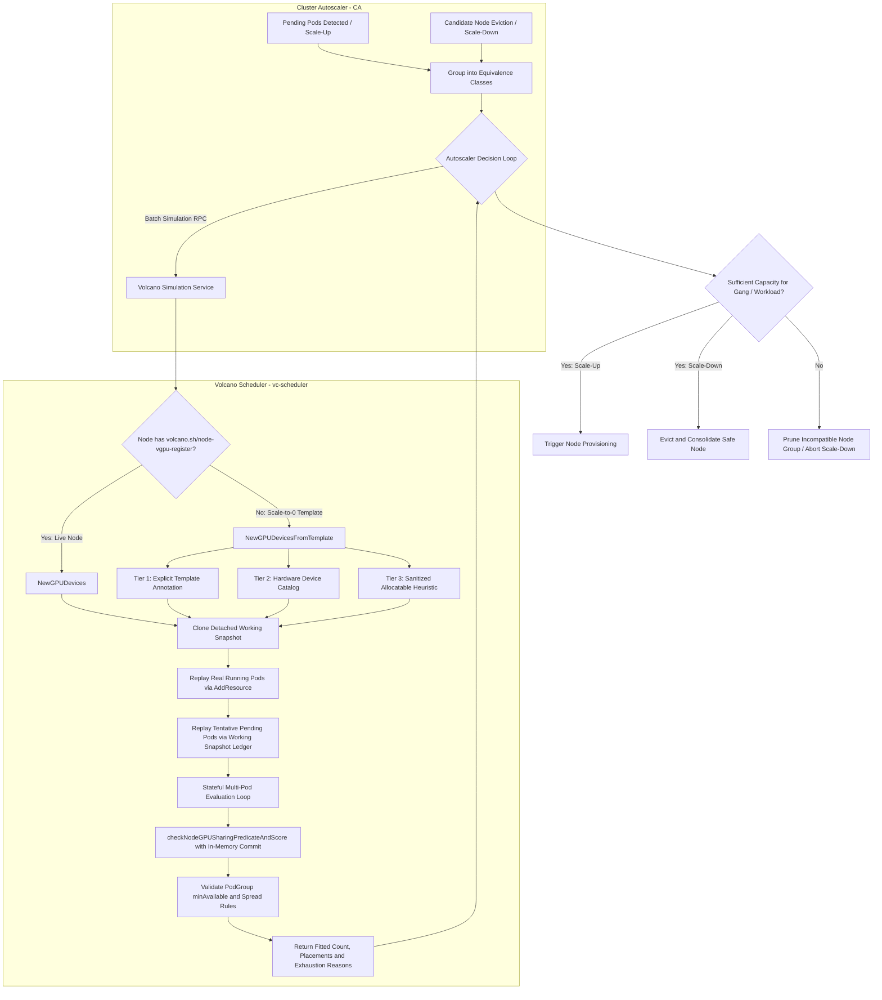
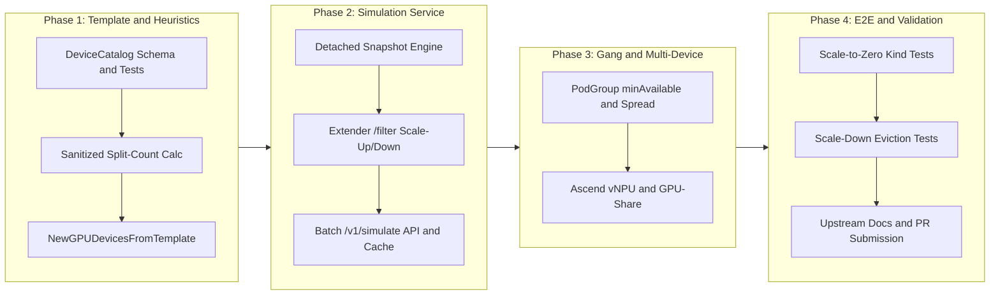

# Design Proposal: GPU-Aware Cluster Autoscaler Integration for Volcano

## 1. Executive Summary

In Kubernetes clusters running heterogeneous AI/ML workloads, fine-grained GPU sharing (NVIDIA vGPU, HAMi-core, MIG, and Ascend vNPU) relies on multi-dimensional device slicing (memory, compute cores, UUIDs, exclusivity, and topology).

Standard Kubernetes **Cluster Autoscaler (CA)** only computes scalar arithmetic over `v1.Node` aggregate allocatable resources (Allocatable − Used ≥ Pod.Request). This introduces severe production failure modes:
1. **The Fragmentation Blindspot (Scale-Up):** Pods remain stuck in `Pending` with `NotTriggerScaleUp` because free VRAM is fragmented across physical GPUs, but CA assumes aggregate capacity can fit the pod.
2. **Incompatible Scale-Up:** CA provisions the wrong GPU node group (e.g., scaling up a cheaper node with 4x 16GB GPUs instead of 1x 80GB GPU) because both satisfy aggregate memory requirements.
3. **The Scale-from-Zero Dilemma:** When node groups are scaled to zero, CA builds synthetic template nodes that lack device driver runtime annotations (such as `volcano.sh/node-vgpu-register`), causing placement checks to fail.
4. **Stateful Multi-Pod Packing Failure:** CA evaluates multi-pod batches on a template node, but tentatively packed pending pods lack device allocation annotations, causing naive ledger replays to silently no-op and over-pack nodes.
5. **Scale-Down Fragmentation Traps:** CA evicts a large vGPU pod from an underutilized node into a target node whose free VRAM is fragmented across cards, causing the evicted pod to get stuck in `Pending` and triggering immediate scale-up thrashing.
6. **Gang Scheduling (PodGroup) Incoherence:** Pod-by-pod CA evaluation triggers partial node scale-ups for distributed training jobs that cannot satisfy `minAvailable`, stranding expensive GPU nodes.

Volcano already possesses the core placement logic inside [`GPUDevices.FilterNode`](../../pkg/scheduler/api/devices/nvidia/vgpu/device_info.go#L307-L319) and [`checkNodeGPUSharingPredicateAndScore(..., replicate=true)`](../../pkg/scheduler/api/devices/nvidia/vgpu/utils.go#L378-L527), which validates per-card memory, compute cores, exclusivity, device type, UUID, and PodGroup constraints against an in-memory snapshot with tentative rollback.

This document presents an end-to-end design addressing both **Scale-Up** and **Scale-Down**, stateful batch packing, template device reconstruction, dynamic MIG geometries, and gang autoscaling coordination.

---

## 2. Background & Production Failure Modes

### 2.1 Virtualized Device Request Dimensions
When a pod requests virtual GPU/NPU resources in Volcano, it requests fine-grained parameters:
* `volcano.sh/vgpu-memory`: Memory request in MiB (e.g., `30000`).
* `volcano.sh/vgpu-cores`: Compute cores percentage from `0` to `100` (e.g., `50`).
* `volcano.sh/vgpu-number`: Number of GPU cards requested by the container (e.g., `1` or `2`).
* Exclusivity constraints: A pod requesting `coresreq == 100` requires exclusive access to the GPU card.
* Model/Device matching: `volcano.sh/gpu-type` (e.g., `A100-SXM4-80GB`).
* UUID constraints: `volcano.sh/vgpu-use-gpuuuid` or `volcano.sh/vgpu-nouse-gpuuuid`.
* PodGroup policies: `volcano.sh/vgpu-podgroup-policy: "spread"` across physical cards.

---

### 2.2 Deep Dive into Real-World Failure Modes

```
Case 1: The Fragmentation Blind Spot (Scale-Up)
Node with 2x 80GB GPUs:
  [GPU 0: 60GB Used / 20GB Free]   [GPU 1: 60GB Used / 20GB Free]
  Aggregate Free VRAM = 40GB

Pending Pod requests 1x 30GB vGPU:
  - Cluster Autoscaler: 30GB <= 40GB free -> "Fits! No scale-up needed." (NotTriggerScaleUp)
  - Volcano vGPU Scheduler: No single GPU has 30GB free -> Unschedulable!
  ==> Result: Pod remains PENDING indefinitely; CA never provisions a new node.

Case 2: Scale-Up to Incompatible Node Group (Wasted Cloud Spend)
Pending Pod requests 1x 40GB vGPU:
  - Node Group A (Cheaper): 4x 16GB T4 GPUs (Total VRAM: 64GB)
  - Node Group B (Pricier): 1x 80GB A100 GPU (Total VRAM: 80GB)
  - Cluster Autoscaler: Evaluates aggregate VRAM (64GB >= 40GB) -> scales up Node Group A!
  - Volcano vGPU Scheduler: Node Group A boots, but card capacity is 16GB < 40GB -> Pod cannot fit!
  ==> Result: Expensive GPU node spun up, but pod still pending.

Case 3: The Scale-to-Zero Template Dilemma
When a node group has 0 nodes:
  - CA creates a synthetic template v1.Node from cloud provider metadata (ASG / MIG / VMSS).
  - The runtime daemonset (vgpu-device-plugin / HAMi daemon) has never run on this node.
  - The critical registration annotation volcano.sh/node-vgpu-register is completely absent!
  - Volcano's NewGPUDevices currently exits immediately with nil if this annotation is missing.

Case 4: Stateful Multi-Pod Binpacking Illusion
Template Node with 1x 80GB A100 GPU. CA evaluates 4 pending pods, each requesting 25GB vGPU:
  - CA simulates Pod 1: Fits on template node. CA marks Pod 1 as "tentatively placed on Node X".
  - CA simulates Pod 2: CA passes Pod 1 as an "existing pod" on Node X.
  - BUT Pod 1 has no apiserver binding annotations (volcano.sh/devices-to-allocate does not exist yet!).
  - Volcano's AddResource(Pod 1) silently no-ops because it cannot find allocation annotations.
  - Volcano thinks GPU 0 has 80GB free again! Pod 2, Pod 3, and Pod 4 all "fit" on the same 80GB card!
  ==> Result: CA provisions 1 node instead of 2. Pods 3 and 4 remain pending after the node boots up.

Case 5: Scale-Down Fragmentation Trap (Eviction Thrashing)
Live Node A is underutilized (1 pod requesting 30GB on an 80GB card).
Target Node B has 2x 80GB cards, each with 60GB used (20GB free per card, 40GB aggregate free):
  - CA Scale-Down evaluates: Node B has 40GB free >= 30GB pod request.
  - CA drains Node A and terminates the instance.
  - Evicted pod attempts to schedule on Node B: Volcano rejects it (no single card has 30GB free).
  - Cluster Autoscaler immediately detects a pending pod and triggers scale-up of a new node!
  ==> Result: Disruptive workload eviction, service downtime, and rapid scale-down/scale-up thrashing.

Case 6: Gang Scheduling (minAvailable) Incoherence
Distributed Training Job requires 4 pods (minAvailable: 4), each requesting 1x 40GB vGPU.
Cloud provider quota or ASG max-size only allows scaling up 2 nodes:
  - Pod-by-pod CA simulates Pod 1 and Pod 2 -> They fit on 2 new nodes.
  - CA triggers scale-up of 2 nodes.
  - Pods 3 and 4 cannot be scaled up.
  - Volcano's gang plugin refuses to bind Pods 1 and 2 because minAvailable (4) is not satisfied.
  ==> Result: 2 expensive GPU nodes sit 100% idle until CA idle-timeout drains them.
```

---

## 3. Analysis: HAMi vs. Upstream CA vs. Volcano

| Dimension | HAMi | Upstream Kubernetes CA | Volcano (`vc-scheduler`) |
| :--- | :--- | :--- | :--- |
| **Placement Logic** | Per-card memory, core, and MIG binpacking. | Pure scalar resource tracking (`cpu`, `memory`, integer `extended-resources`). | Comprehensive placement in [`utils.go`](../../pkg/scheduler/api/devices/nvidia/vgpu/utils.go#L378-L527) (`checkNodeGPUSharingPredicateAndScore`). |
| **Dry-Run Simulation** | In-memory ledger replay; exposed via scheduler extender filter. | Internal simulator mimics `kube-scheduler` in-process; does not call extenders during simulation by default. | Built-in via [`GPUDevices.FilterNode`](../../pkg/scheduler/api/devices/nvidia/vgpu/device_info.go#L307-L319) with `replicate=true`, [`getGPUDeviceSnapShot`](../../pkg/scheduler/api/devices/nvidia/vgpu/utils.go#L310-L347), [`DeepCopy`](../../pkg/scheduler/api/devices/nvidia/vgpu/device_info.go#L360-L405), and automatic `rollbackTentative`. |
| **Scale-from-Zero** | Requires template annotations or external device spec. | Synthesizes `v1.Node` with allocatable scalars, but no driver-level device annotations. | Relies on live node annotation `volcano.sh/node-vgpu-register` ([`VolcanoVGPURegister`](../../pkg/scheduler/api/devices/config/vgpu.go#L28-L29)). Returns `nil` on template nodes. |
| **Multi-Pod Batching** | Evaluated pod-by-pod; vulnerable to missing annotation no-ops in tentative states. | Maintains internal node snapshot, but depends on scheduler plugin to account for tentative extended resources. | Currently lacks tentative state ledger across multiple unassigned pods in simulation batches. |
| **Multi-Accelerator** | Primarily NVIDIA (and experimental Ascend). | Unaware of accelerator topology. | Unified abstraction via [`Devices` interface](../../pkg/scheduler/api/shared_device_pool.go#L34-L92): NVIDIA vGPU, NVIDIA GPU share, Ascend MindCluster vNPU, Ascend HAMi vNPU. |

---

## 4. System Architecture



---

## 5. Detailed Technical Specifications

### 5.1 Component 1: Node Template Device Constructor (`NewGPUDevicesFromTemplate`)

Located in [`pkg/scheduler/api/devices/nvidia/vgpu/device_info.go`](../../pkg/scheduler/api/devices/nvidia/vgpu/device_info.go):

```go
func NewGPUDevicesFromTemplate(name string, node *v1.Node, catalog DeviceCatalog) (*GPUDevices, error)
```

A robust 3-tier resolution strategy constructs the device inventory when `volcano.sh/node-vgpu-register` is absent:

#### Tier 1: Explicit Template Annotation (Zero-Drift, Declarative)
- Inspect node annotations:
  - `volcano.sh/node-vgpu-register` (identical format to live daemonset — the constant `VolcanoVGPURegister`).
  - `volcano.sh/node-template-gpu-spec` (concise human-readable YAML/JSON, a new annotation for template nodes).
- If present, decode directly via `decodeNodeDevices(name, annos)`.

#### Tier 2: Device Catalog & Hardware Profile Lookup
- Read cloud provider instance labels:
  - `node.kubernetes.io/instance-type` (e.g., `p4d.24xlarge`, `g5.12xlarge`, `g4dn.xlarge`).
  - Accelerator labels: `k8s.amazonaws.com/accelerator`, `cloud.google.com/gke-accelerator`.
- Query a configurable `DeviceCatalog` (ConfigMap or embedded defaults).
- **MIG Profile Differentiation:**
  - **Static MIG Profiles:** For node pools configured with static MIG partitions (e.g., each A100 pre-split into 2x `3g.40gb`), the catalog defines explicit MIG instances per card.
  - **Dynamic MIG Geometries:** For node pools with dynamic MIG slicing, the catalog specifies the physical card model (e.g., `A100-SXM4-80GB`) and Volcano loads valid geometry split tables from [`pkg/scheduler/api/devices/nvidia/vgpu/mig.go`](../../pkg/scheduler/api/devices/nvidia/vgpu/mig.go) to validate allowed partition combinations dynamically.

```json
{
  "p4d.24xlarge": {
    "vendor": "NVIDIA",
    "model": "A100-SXM4-40GB",
    "cardCount": 8,
    "memoryPerCard": 40960,
    "coresPerCard": 100,
    "mode": "hami-core"
  },
  "a2-highgpu-1g": {
    "vendor": "NVIDIA",
    "model": "A100-SXM4-40GB",
    "cardCount": 1,
    "memoryPerCard": 40960,
    "coresPerCard": 100,
    "mode": "mig",
    "migGeometries": ["1g.5gb", "2g.10gb", "3g.20gb", "7g.40gb"]
  }
}
```

#### Tier 3: Sanitized Allocatable Heuristic (Fixing the Split-Count Flaw)
*Warning on raw Allocatable:* In Volcano/HAMi, `node.Status.Allocatable[volcano.sh/vgpu-number]` is often a **virtual multiplier** (e.g., `device-split-count = 10`, so an 8-GPU node advertises `volcano.sh/vgpu-number: 80` to allow up to 80 pods to share the 8 cards). Dividing total memory by 80 erroneously creates 80 tiny cards!

**Sanitized Calculation Rules:**
1. Determine Physical Card Count:
   - **Preferred:** Use `Allocatable[nvidia.com/gpu]` if present (reports real physical GPUs).
   - **Fallback 1:** Use node label `volcano.sh/gpu-card-count` if present.
   - **Fallback 2:** Divide `Allocatable[volcano.sh/vgpu-number]` by `DeviceSplitCount` (default 10).
2. Calculate Per-Card VRAM:
   - `VRAMPerCard = Allocatable[volcano.sh/vgpu-memory] × MemoryFactor / PhysicalCards`
   - *(where `MemoryFactor` handles 1 MiB vs 100 MiB block configurations).*
3. Assign Cores: Each physical card receives `Devcore: 100`.

---

### 5.2 Component 2: Volcano Autoscaler Simulation Service

Exposed inside Volcano Scheduler's HTTP server in [`cmd/scheduler/app/server.go`](../../cmd/scheduler/app/server.go). The simulation endpoints are added to the existing `startMetricsServer` mux (or a new dedicated mux if the scheduler gains a separate simulation port).

#### 5.2.1 Protocol A: Kubernetes Scheduler Extender `/filter` API
- **Endpoint:** `POST /scheduler/filter`
- Implements standard `extenderv1.ExtenderArgs` → `extenderv1.ExtenderFilterResult`.
- Invoked by Cluster Autoscaler during both **Scale-Up Simulation** and **Scale-Down Consolidation (`FindPlaceFor`)**.

#### 5.2.2 Protocol B: Granular Batch Simulation API (`/v1/simulate`)
Optimized for high-throughput modern autoscalers (Cluster Autoscaler, Karpenter).

- **Request Body:**
  ```json
  {
    "candidateNode": {
      "node": { "apiVersion": "v1", "kind": "Node" },
      "isTemplate": true,
      "runningPods": []
    },
    "podBatch": {
      "podTemplate": { "apiVersion": "v1", "kind": "Pod" },
      "requestedReplicas": 8,
      "podGroup": {
        "name": "llm-train-job",
        "minAvailable": 8,
        "policy": "spread"
      }
    },
    "schedulePolicy": "binpack"
  }
  ```

- **Response Body:**
  ```json
  {
    "fittedReplicas": 4,
    "gangSatisfied": false,
    "allocations": [
      { "replicaIndex": 0, "cardIndex": 0, "allocatedVRAM": 20000, "allocatedCores": 50 },
      { "replicaIndex": 1, "cardIndex": 0, "allocatedVRAM": 20000, "allocatedCores": 50 },
      { "replicaIndex": 2, "cardIndex": 1, "allocatedVRAM": 20000, "allocatedCores": 50 },
      { "replicaIndex": 3, "cardIndex": 1, "allocatedVRAM": 20000, "allocatedCores": 50 }
    ],
    "exhaustionReason": "Card cores exhausted: all 2 physical cards reached 100% core allocation"
  }
  ```

---

### 5.2.3 Solving the Multi-Pod Stateful Ledger Problem (Gap 1)

When CA packs multiple pods onto a template node, [`AddResource(existingPod)`](../../pkg/scheduler/api/devices/nvidia/vgpu/device_info.go#L180-L214) fails because tentative pods lack the `volcano.sh/devices-to-allocate` annotation (constant [`AssignedIDsToAllocateAnnotations`](../../pkg/scheduler/api/devices/nvidia/vgpu/type.go#L29)).

**The Solution: Working Snapshot Ledger**
1. When a simulation starts, clone a detached `GPUDevices` working snapshot via [`getGPUDeviceSnapShot`](../../pkg/scheduler/api/devices/nvidia/vgpu/utils.go#L310-L347) or [`DeepCopy`](../../pkg/scheduler/api/devices/nvidia/vgpu/device_info.go#L360-L405).
2. For real running pods on the node, populate the snapshot via `AddResource(runningPod)` — these pods already have `volcano.sh/devices-to-allocate` annotations from their original scheduling.
3. For pending pods tentatively placed on the node earlier in CA's loop:
   - Call `checkNodeGPUSharingPredicateAndScore(pod, workingSnapshot, replicate=false, policy)`.
   - **Crucial:** `replicate=false` causes the function to operate directly on the passed-in `GPUDevices` pointer (line 402: `gs = gssnap`). The tentative allocations via `TryAddPod` commit the usage (`UsedMem`, `UsedCore`, `UsedNum`) into the **working snapshot only**.
   - Subsequent pods in the simulation batch immediately see the updated per-card capacity.
4. When the simulation request finishes, the detached working snapshot is discarded. The live scheduler state is never touched.

> **Note:** When `replicate=true` (the normal `FilterNode` path), `checkNodeGPUSharingPredicateAndScore` first creates a snapshot via `getGPUDeviceSnapShot` (line 400) and uses the local `rollbackTentative` closure (lines 414-433) to undo tentative allocations if placement fails. For simulation, we skip both the inner snapshot and rollback by using `replicate=false` on our already-detached working copy.

---

### 5.2.4 Scale-Down & Consolidation Safety (Gap 3)

Scale-Down in CA uses the `FindPlaceFor` function to check if pods on an underutilized node can be rescheduled elsewhere before draining it.
* To prevent the **Scale-Down Fragmentation Trap**, CA's `FindPlaceFor` simulation invokes `/scheduler/filter`.
* Volcano verifies whether target live nodes have **contiguous per-card VRAM and cores** to host the candidate pod.
* If target nodes only have fragmented VRAM, Volcano fails the filter check.
* CA aborts the eviction of Node A, preventing service downtime and scale-up thrashing.

---

### 5.2.5 Performance, Caching & Lock-Free Isolation (Gap 6)

In large clusters (5,000 pending pods, 30 node groups), naive per-pod HTTP RPCs produce 150,000 calls every 10 seconds.

**Mitigation Strategies:**
1. **Pod Equivalence Grouping:** CA groups pods with identical specs (same ReplicaSet/Job). The `/v1/simulate` API accepts `requestedReplicas: N`, allowing CA to determine how many pods fit on 1 node instance in a single RPC.
2. **Equivalence Result Cache:** Volcano caches `(NodeTemplateHash, PodSpecHash) → MaxReplicasFit` for 10 seconds.
3. **Lock-Free Read-Only Isolation:** The simulation engine operates exclusively on detached struct copies (via `getGPUDeviceSnapShot` or `DeepCopy`). It **never acquires the main scheduler cycle lock**, guaranteeing zero latency impact on live cluster scheduling.

---

### 5.3 Component 3: Volcano Gang Scheduling (PodGroup) Coordination (Gap 2)

Volcano's primary differentiator is **All-or-Nothing Gang Scheduling**.

#### The Problem:
If an 8-pod gang requires 8 nodes, but cloud limits only permit scaling 4 nodes, CA scaling up 4 nodes wastes budget because the job cannot run.

#### The Architecture:
```
+-----------------------------------------------------------------------------------+
| 1. Queue & Quota Admission Gate (SchedulingGate)                                  |
|    - Volcano's Queue controller applies schedulingGates to PodGroup pods.         |
|    - Pods are withheld from CA's pending queue until queue quota is available,     |
|      preventing runaway cloud scaling for queue-blocked jobs.                      |
+-----------------------------------------------------------------------------------+
| 2. Atomic Gang Scale-Up Validation                                                |
|    - The simulation API reports `gangSatisfied: true/false`.                       |
|    - If `totalFittedAcrossNodeGroups < podGroup.minAvailable`, CA aborts the      |
|      scale-up for that job, logging: "Cannot satisfy gang minAvailable (8)".       |
+-----------------------------------------------------------------------------------+
| 3. PodGroup Spread Policy Preservation                                            |
|    - When `volcano.sh/vgpu-podgroup-policy: "spread"` is configured, the          |
|      working snapshot records PodGroupKey in each card's PodMap.                   |
|    - Sibling pods in the same gang are forced onto separate physical GPUs          |
|      (enforced by deviceHasPodFromSameGroup check in utils.go line 457).           |
+-----------------------------------------------------------------------------------+
```

---

## 6. Key Source Code References

This section maps each design component to the exact Volcano source code it extends:

| Component | Existing Code | What We Add |
| :--- | :--- | :--- |
| **Device Registration Check** | [`NewGPUDevices`](../../pkg/scheduler/api/devices/nvidia/vgpu/device_info.go#L94-L140) checks `VolcanoVGPURegister` annotation | Add `NewGPUDevicesFromTemplate` fallback when annotation is absent |
| **Per-Card Placement Logic** | [`checkNodeGPUSharingPredicateAndScore`](../../pkg/scheduler/api/devices/nvidia/vgpu/utils.go#L378-L527) | Reuse with `replicate=false` on detached snapshots for simulation |
| **Snapshot & Rollback** | [`getGPUDeviceSnapShot`](../../pkg/scheduler/api/devices/nvidia/vgpu/utils.go#L310-L347) + [`rollbackTentative`](../../pkg/scheduler/api/devices/nvidia/vgpu/utils.go#L414-L433) | Use snapshot isolation for simulation working copies |
| **Deep Copy** | [`GPUDevices.DeepCopy`](../../pkg/scheduler/api/devices/nvidia/vgpu/device_info.go#L360-L405) | Use for simulation isolation |
| **AddResource** | [`GPUDevices.AddResource`](../../pkg/scheduler/api/devices/nvidia/vgpu/device_info.go#L180-L214) requires `volcano.sh/devices-to-allocate` | Working snapshot ledger bypasses annotation dependency |
| **Devices Interface** | [`Devices`](../../pkg/scheduler/api/shared_device_pool.go#L34-L92) — implemented by vgpu, gpushare, vnpu, hami | Add `FromTemplate` constructors for each device type |
| **Node Device Init** | [`setNodeOthersResource`](../../pkg/scheduler/api/node_info.go#L370) calls `NewGPUDevices`, `NewNPUDevices`, `NewAscendDevices` | Add template-aware fallback path |
| **MIG Geometries** | [`mig.go`](../../pkg/scheduler/api/devices/nvidia/vgpu/mig.go) | Reference for valid MIG partition profiles in DeviceCatalog |
| **HTTP Server** | [`startMetricsServer`](../../cmd/scheduler/app/server.go#L154-L180) in `server.go` | Add `/scheduler/filter` and `/v1/simulate` handlers |
| **PodGroup Spread** | [`deviceHasPodFromSameGroup`](../../pkg/scheduler/api/devices/nvidia/vgpu/utils.go#L457) + [`GPUUsage.PodGroupKey`](../../pkg/scheduler/api/devices/nvidia/vgpu/device_info.go#L34-L38) | Maintain PodGroupKey tracking in simulation working copies |

---

## 7. Implementation Plan & Milestones



| Phase | Milestone / Deliverable | Status / Scope |
| :--- | :--- | :--- |
| **Phase 1** | DeviceCatalog schema, Sanitized Tier 3 heuristic, `NewGPUDevicesFromTemplate` (vGPU & MIG) | Core Foundation |
| **Phase 2** | Detached Working Snapshot engine, Extender `/filter`, Batch `/v1/simulate` API & Cache | Simulation Service |
| **Phase 3** | PodGroup minAvailable & Spread coordination, Ascend vNPU & GPU-share templates | Advanced Workloads |
| **Phase 4** | Scale-to-zero e2e tests, Scale-down eviction safety tests, Upstream documentation & PR | Verification & Release |

### Phase 1: Template Engine & Sanitized Heuristics
- Implement `DeviceCatalog` lookup in `pkg/scheduler/api/devices/catalog/catalog.go`.
- Implement `NewGPUDevicesFromTemplate` in [`device_info.go`](../../pkg/scheduler/api/devices/nvidia/vgpu/device_info.go) with sanitized split-count and memory factor calculations.
- Support both dynamic and static MIG template geometries using [`mig.go`](../../pkg/scheduler/api/devices/nvidia/vgpu/mig.go).

### Phase 2: Simulation Service & Stateful Batch Packing
- Build the detached working snapshot engine in `pkg/scheduler/autoscaler/simulator.go`.
- Implement `/scheduler/filter` supporting both Scale-Up and Scale-Down (`FindPlaceFor`).
- Implement `/v1/simulate` supporting batch packing and pod equivalence caching.

### Phase 3: Gang Scheduling Coordination & Multi-Accelerator
- Implement PodGroup spread validation across simulated pods.
- Implement `NewNPUDevicesFromTemplate` for Ascend vNPU (MindCluster `vnpu` and `hami` packages).
- Connect Volcano's `SchedulingGate` controller to guard queue-blocked workloads.

### Phase 4: End-to-End Validation
- Validate scale-to-zero on AWS `p4d`/`g4dn` template nodes.
- Validate scale-down protection preventing eviction into fragmented live nodes.
- Benchmark concurrent simulation calls to prove lock-free isolation from `vc-scheduler`.

