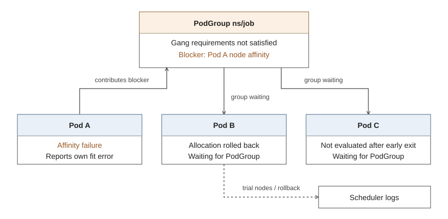
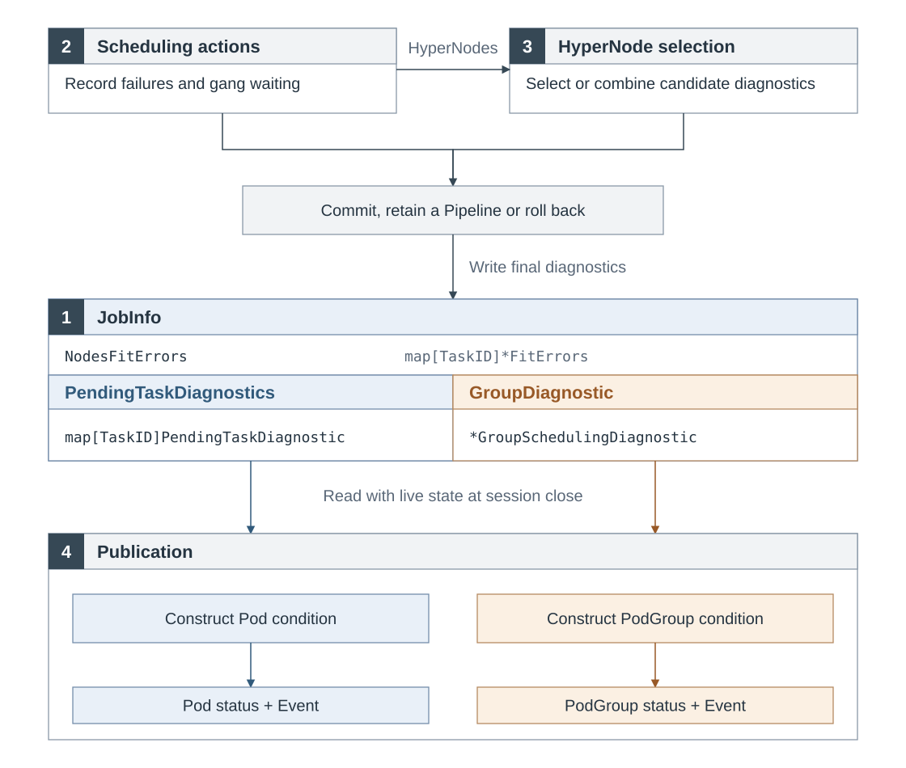
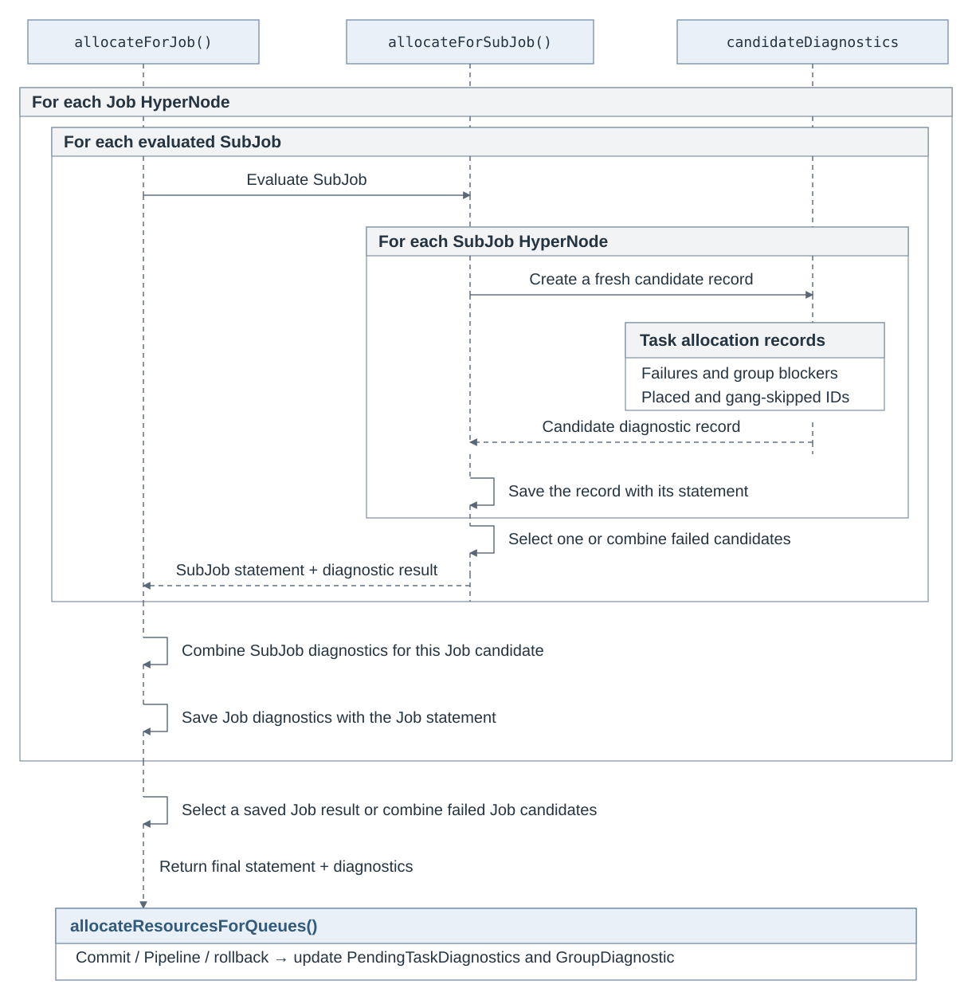
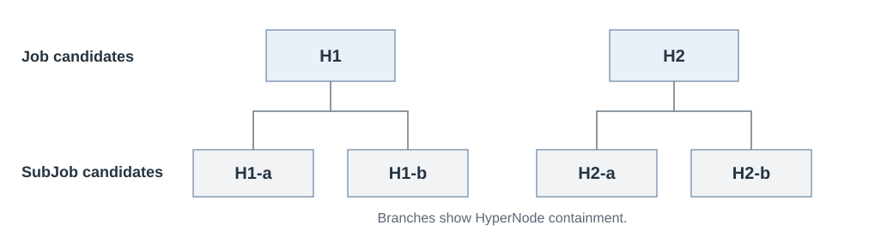
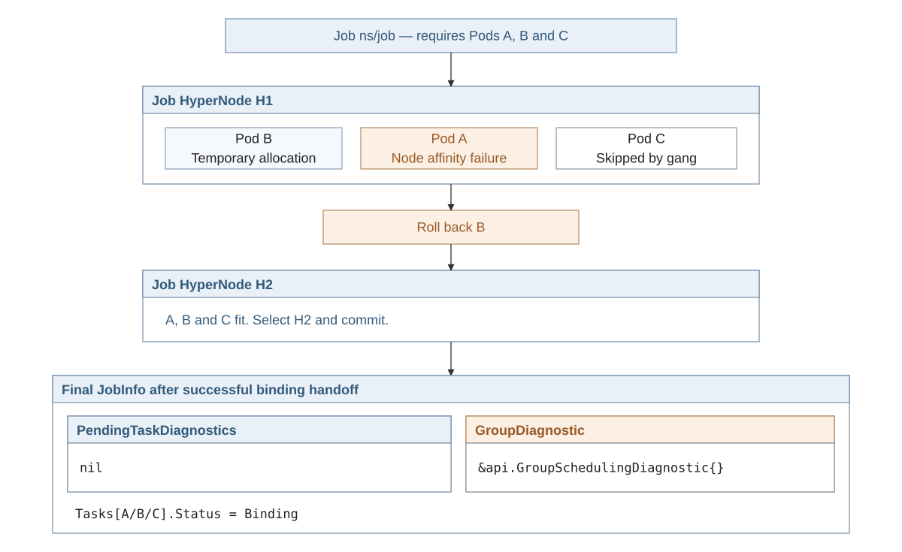
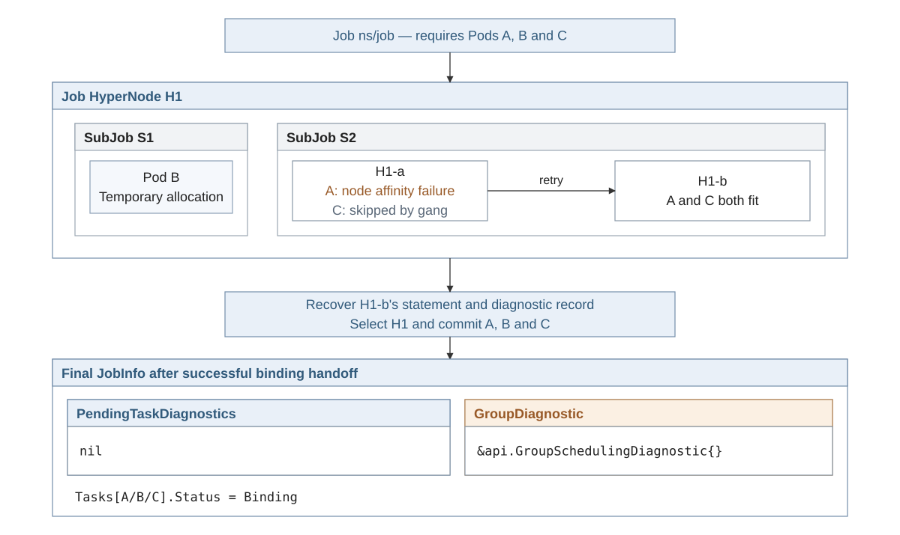
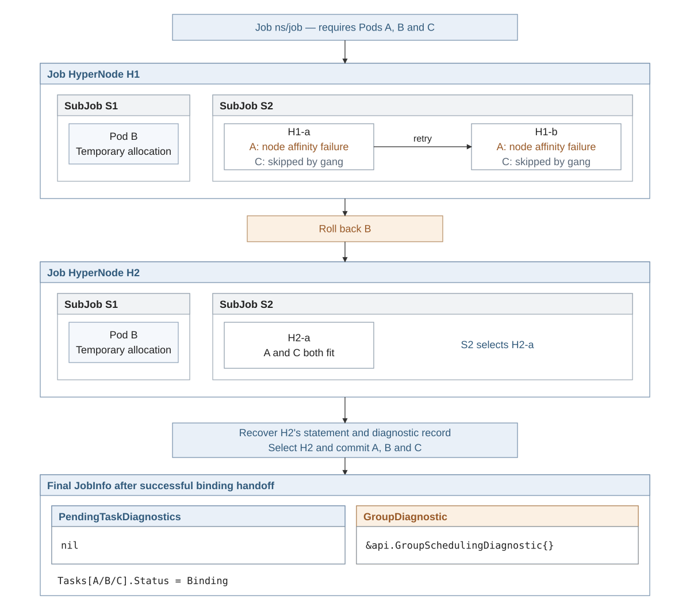
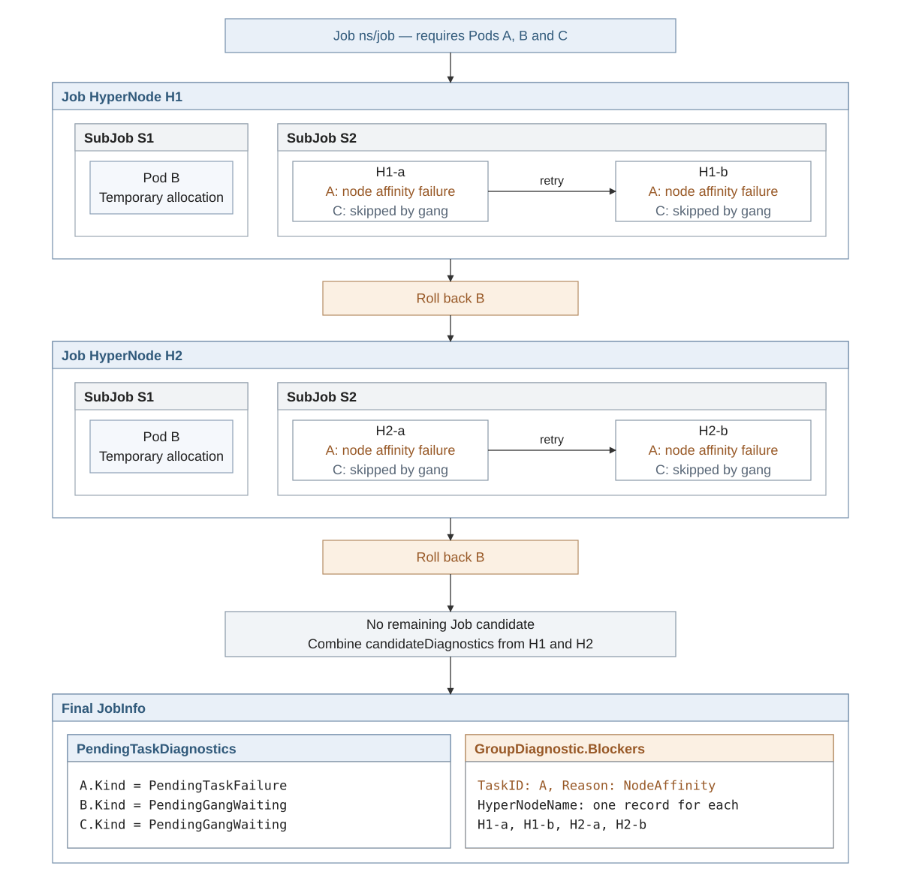
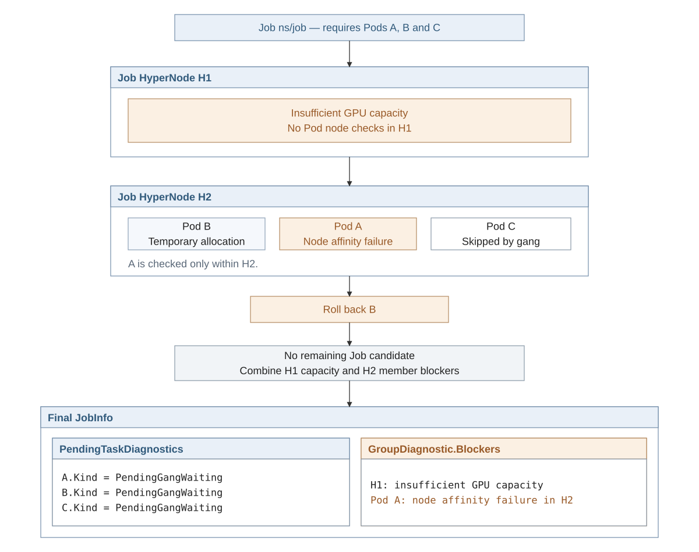
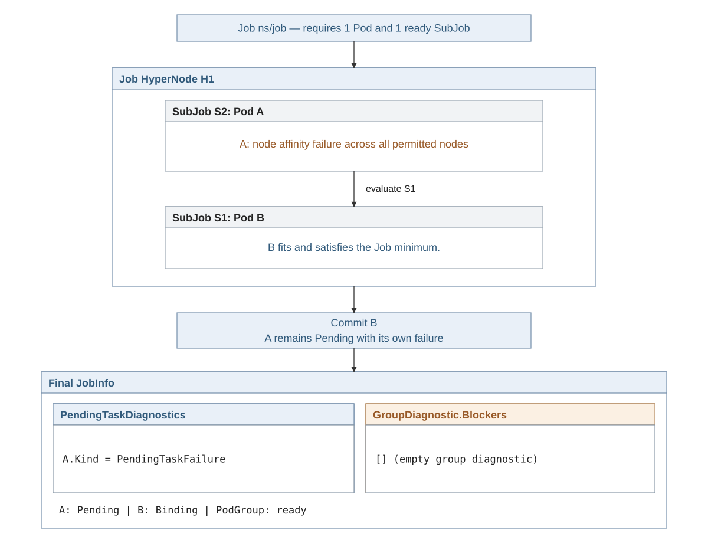

# Stable Pod and PodGroup Scheduling Diagnostics

<!-- toc -->

- [Summary](#summary)
- [Motivation](#motivation)
  - [Problems](#problems)
  - [Impact](#impact)
  - [Goals](#goals)
- [Proposal](#proposal)
  - [Pod and PodGroup Reporting](#pod-and-podgroup-reporting)
  - [Architecture](#architecture)
- [Design Details](#design-details)
  - [1. New Fields in JobInfo](#1-new-fields-in-jobinfo)
  - [2. Recording Action Results](#2-recording-action-results)
  - [3. HyperNode Attempts](#3-hypernode-attempts)
  - [4. Publishing Conditions and Events](#4-publishing-conditions-and-events)
- [Risks and Mitigations](#risks-and-mitigations)
- [Test Plan](#test-plan)
- [Related Issues and References](#related-issues-and-references)

<!-- /toc -->

## Summary

Volcano currently uses temporary scheduling results to explain why a Pod is Pending. After an allocation or Pipeline is rolled back, a message such as `can possibly be assigned to <node>` can still reach the Pod's condition and Event. Trying another node, or skipping that Pod on the next gang attempt, changes the diagnostic even though the scheduling blocker has not changed. HyperNode simulation amplifies this churn by trying and discarding placements across multiple candidate domains.

These message and reason changes defeat the existing no-op checks, causing **repeated Pod status and Event API writes**. Successful status writes also generate Pod watch notifications and informer/cache processing. With many Pending Pods, this adds API-server and scheduler work without scheduling progress. Some Pods also inherit the entire PodGroup's failure, so members of the same group can give inconsistent explanations.

This design publishes each Pod's own failure or a stable group-waiting condition, and puts aggregate scheduling failures on the PodGroup. Actions record confirmed Pending-task failures and gang waiting. At session close, the publisher combines these records with live task state to construct conditions and Events. Trial placements and rollback details go to debug logs. Stable diagnostics let existing comparisons skip redundant Pod writes while still reporting a changed blocker or real progress.

## Motivation

A PodGroup may require several scheduling attempts before its gang requirements can be satisfied. During each attempt, Volcano can allocate or Pipeline some Pods, stop evaluating other members, and roll back temporary placements when the group cannot proceed. HyperNode scheduling repeats this process across candidate domains.

The current reporting path builds Pod and PodGroup messages from the intermediate results of these attempts. **The messages then change from one session to the next while the scheduling blocker stays the same.** Pod and PodGroup messages also carry each other's information.

The four problems below describe this. Problems 1 to 3 change a message while the blocker stays the same, and they are the ones that cost API writes. Problem 4 makes the messages hard to read.

### Problems

#### Problem 1: A rolled-back trial node appears in the Pod message

Reported in [#6196](https://github.com/volcano-sh/volcano/issues/6196). `Statement.Discard()` saves a task's trial placement in `LastTransaction` before undoing it. `TaskSchedulingReason()` prefers that snapshot, so a Pod that is Pending again still names the node it was tried on. The report shows two Pods before and after one more session, shortened here:

```text
candidate-a, before: Pod ns/candidate-a can possibly be assigned to worker2, once resource is released and minAvailable is satisfied; HyperNode: 0/2 hyperNodes available (...)
candidate-a, after:  Pod ns/candidate-a can possibly be assigned to worker, once resource is released and minAvailable is satisfied; HyperNode: 0/2 hyperNodes available (...)

candidate-b, before: Pod ns/candidate-b can possibly be assigned to worker, once resource is released and minAvailable is satisfied; HyperNode: 0/2 hyperNodes available (...)
candidate-b, after:  HyperNode: 0/2 hyperNodes available (...)
```

Neither Pod was bound or nominated, and no victim was evicted. Any rolled-back gang attempt takes this path. Three things make the trial node change while the cluster stays the same:

- **HyperNode trials:** HyperNode scheduling tries the Job or SubJob in every candidate HyperNode and discards each trial before it selects one. Every discard overwrites `LastTransaction`, so the Pod names the node of the trial that was discarded last.
- **Equal scores:** `SelectBestNodeAndScore()` and `SelectBestHyperNodeAndScore()` pick randomly among candidates with the same score. The trial node can differ in each session.
- **Gang early exit:** Members are tried in order. When a member finds no node and the gang can no longer be satisfied, the attempt stops and the remaining members are not tried. Which member fails first depends on the nodes that the earlier members were tried on. For example, C fits only node-1. When B is tried on node-2, C and the members after it get a trial node. When B is tried on node-1, C fails and the members after it are not tried. A member after C then has a trial node in one session and none in the next. Its message loses the prefix, and for a trial allocation its reason switches between `Schedulable` and `Unschedulable`.

#### Problem 2: Node totals and per-reason counts appear in the Pod message

Reported in [#6081](https://github.com/volcano-sh/volcano/issues/6081). A Pod that finds no node reports `FitErrors.Error()`, which counts the nodes behind each reason:

```text
0/400 nodes are unavailable: 123 Insufficient cpu, 277 Insufficient memory.
```

The counts describe the whole cluster. When the idle resources of one node change, or one unrelated Pod is scheduled, they change for every Pending Pod, although each Pod still fails for the same reasons. With HyperNode scheduling, the message also starts with `In hyperNode <name>:`, which names the candidate that was tried last.

#### Problem 3: The PodGroup condition, its Event and the Pods count the same gang differently

Reported in [#6200](https://github.com/volcano-sh/volcano/issues/6200). Three code paths summarize one failed gang, each with its own count. For a PodGroup of two Pods, the report shows:

```text
PodGroup condition: 1/2 tasks in gang unschedulable: pod group is not ready, 2 Pending, 2 minAvailable; Pending: 1 Schedulable, 1 Unschedulable
PodGroup Event:     2/2 tasks in gang unschedulable: pod group is not ready, 2 Pending, 2 minAvailable; Pending: 1 Schedulable, 1 Unschedulable
Pod condition:      pod group is not ready, 2 Pending, 2 minAvailable; Pending: 1 Schedulable, 1 Unschedulable
```

- **PodGroup condition:** `gang.OnSessionClose()` subtracts the tasks that `LastTransaction` shows as placed, so its count depends on rolled-back trials.
- **PodGroup Event:** `RecordJobStatusEvent()` counts all Pending tasks.
- **Pod condition:** A Pod without its own message falls back to `job.FitError()`, the summary of the whole Job.

The `Schedulable` and `Unschedulable` counts in that summary also come from `LastTransaction`. When Problem 1 moves one Pod between the two, the PodGroup message changes, and so does the message of every Pod that uses the fallback.

#### Problem 4: Pod and PodGroup messages carry each other's information

The [Scheduling Reason](scheduling-reason.md) design puts the summary of the whole group on the Pods that were not tried. The current messages mix the two objects in both directions:

- **Group information on a Pod:** A Pod without its own message reports the Job summary, as in Problem 3. A Pod with a trial node also carries the HyperNode summary of its Job, as in Problem 1: `...; HyperNode: 0/2 hyperNodes available (...)`.
- **Pod information on the PodGroup:** The Job summary appends the node counts of one member, in the form `Node: <task name>: <its fit error>`.

Members of one group can then report three kinds of explanation: their own fit error, a rolled-back trial node, or the summary of the whole group. A user cannot tell from a Pod whether that Pod is the blocker, and has to read the PodGroup and every Pod to find the member that failed.

### Impact

Problems 1 to 3 share one cause. The published message is built from trial placements and cluster-wide counts, so it changes while the blocker stays the same.

These changing conditions defeat the existing status comparison and trigger repeated Pod status and Event API writes. Each successful Pod status update produces watch notifications and further informer/cache processing. Across large gangs and repeated HyperNode simulations, this creates sustained API-server and scheduler overhead without scheduling progress. Frequent diagnostic changes also make it harder for users to identify the actual blocker and distinguish a meaningful scheduling change from another unsuccessful retry.

Problem 4 does not add writes by itself. It spreads each change further: a change in one member's trial result or in the group summary reaches the PodGroup and every Pod that repeats the summary.

### Goals

- Stop changes caused only by trial nodes, discarded placements or gang early exit from becoming Pod status updates.
- Keep individual Pod errors attributable and put group failures on PodGroup.
- Give conditions and Events consistent messages while preserving genuine changes, nomination and useful debug detail.

## Proposal

`Discard()` saves the temporary task context in `LastTransaction` before undoing a placement. The reporting path later uses that snapshot to describe a Pending Pod. Replace this input with the task's live state and a session-local record of why it is Pending. **Actions record the scheduling result. The publisher constructs the condition and Event message at session close.**

Add `PendingTaskDiagnostics` to `JobInfo`. It records a confirmed individual failure or that a member is waiting because its gang attempt failed. A retained Pipeline, retained allocation or successful binding handoff is read from the current task state. The publisher uses these inputs to select the explanation and compare it with the current Pod status.

HyperNode attempts collect group blockers with the affected members and checked domains, and preserve the individual failure evidence needed by a candidate result. After the enclosing decision settles, the action updates the affected Pending-task records. Group blockers go to `GroupDiagnostic` for PodGroup reporting. Trial nodes and rollback operations go to scheduler logs.

### Pod and PodGroup Reporting

A Pod reports its own failure or a stable reference to the PodGroup it is waiting for. The PodGroup explains the group failure. Scheduler debug logs record trial placements and rollback details.

For a three-member gang, assume A fails node affinity, B finds a placement that is rolled back, and C is skipped after gang early exit:

| Object | Condition | Event | Message |
| --- | --- | --- | --- |
| Pod A | `PodScheduled=False`, reason `Unschedulable` | `Warning / FailedScheduling` | `No eligible node satisfies this Pod's node affinity.` |
| Pod B | `PodScheduled=False`, reason `Unschedulable` | `Warning / FailedScheduling` | `Waiting for PodGroup ns/job to satisfy gang requirements.` |
| Pod C | `PodScheduled=False`, reason `Unschedulable` | `Warning / FailedScheduling` | `Waiting for PodGroup ns/job to satisfy gang requirements.` |
| PodGroup ns/job | `Unschedulable=True`, reason `NotEnoughResources` | `Warning / Unschedulable` | `Gang requirements are not satisfied. Pod ns/A has no node satisfying node affinity.` |

Pod A reports its own affinity failure and contributes the member node affinity blocker to the PodGroup. Pods B and C report that they are waiting for the PodGroup. These explanations stay stable across retries with the same blocker. Scheduler logs record the candidate nodes and rollback operations from each attempt.

[Scheduling Reason](scheduling-reason.md#message-reference) lists the message of every Pod and PodGroup state.



### Architecture

Scheduling actions know which tasks were evaluated, which members were stopped by gang failure, and which results survived candidate selection. They write that information to `PendingTaskDiagnostics` after the relevant decision settles. Node checks continue to collect working errors in `NodesFitErrors`, and completed group checks supply the blockers in `GroupDiagnostic`.

At session close, the reporting code in `JobUpdater` and `SchedulerCache` acts as the publisher. It reads live task state first, then uses `PendingTaskDiagnostics` to explain tasks that are still Pending. It formats the selected failure or waiting message and builds the Kubernetes condition. PodGroup reporting combines the group summary with actual group state.

This separates candidate evaluation from API publication. A later action can replace a Pending diagnostic or move the task into a retained allocation, Pipeline or binding state. The publisher reports the resulting state, and its comparisons skip repeated Pod writes when condition and nomination are unchanged.

## Design Details

The four numbered parts match the sections below. Actions record results, and HyperNode scheduling selects or combines candidate diagnostics before writing the final result to `JobInfo`. At session close, the publisher reads those fields together with live state. Blue marks Pod reporting and orange marks PodGroup reporting.



### 1. New Fields in JobInfo

Add two session-local diagnostic fields in `api/job_info.go`. `PendingTaskDiagnostics` explains individual Pending Pods. `GroupDiagnostic` explains the PodGroup after a scheduling attempt reaches a group conclusion. It replaces the formatted `JobFitErrors` string with a result that the publisher can turn into a condition and Event message.

```go
// JobInfo fields used by scheduling diagnostics.
type JobInfo struct {
    NodesFitErrors         map[TaskID]*FitErrors
    PendingTaskDiagnostics map[TaskID]PendingTaskDiagnostic
    GroupDiagnostic        *GroupSchedulingDiagnostic
}
```

`NodesFitErrors` holds working errors from node checks. The two diagnostic fields hold results selected for publication. Candidate evaluation collects its data locally, and the action updates these fields when it establishes the result to report.

#### PendingTaskDiagnostics

A Pod can return to Pending because it failed its own checks or because another member prevented the gang from proceeding. The map records this distinction using the task UID as its key:

```go
type PendingTaskDiagnosticKind uint8

const (
    PendingTaskFailure PendingTaskDiagnosticKind = iota + 1
    PendingGangWaiting
)

type PendingTaskDiagnostic struct {
    Kind PendingTaskDiagnosticKind

    // Used by PendingTaskFailure.
    Reason  string
    Failure error
}
```

`PendingTaskFailure` carries the condition reason and the confirmed error to format at publication. The recording path retains that error with stable contents until publication finishes. `PendingGangWaiting` uses only `Kind`, from which the publisher generates the group-waiting explanation.

**The map stores only Pending diagnostics.** The publisher combines these records with live task state. The following examples show what is recorded and what the Pod reports:

- **Pod A fails its own affinity checks.** The completed search finds no feasible node in A's permitted scope. Store the following record under A's task UID:

    ```go
    api.PendingTaskDiagnostic{
        Kind:    api.PendingTaskFailure,
        Reason:  api.PodReasonUnschedulable,
        Failure: fitErrors,
    }
    ```

    If A is still Pending at publication, the publisher formats the saved `FitErrors` and builds `PodScheduled=False` with reason `Unschedulable`. A's condition and `FailedScheduling` Event both explain its own affinity failure.

- **Pods B and C wait for the gang.** B's temporary allocation is rolled back because A failed, and C's evaluation stops at gang early exit. Store the following record under each affected task's UID:

    ```go
    api.PendingTaskDiagnostic{Kind: api.PendingGangWaiting}
    ```

    This record uses only `Kind`. For each Pod still Pending at publication, the publisher builds `PodScheduled=False` with reason `Unschedulable` and message `Waiting for PodGroup ns/job to satisfy gang requirements.`. The corresponding `FailedScheduling` Event uses the same message.

- **Pod B later becomes Pipelined.** Preemption retains a Pipeline for B and removes B's Pending record:

    ```go
    delete(job.PendingTaskDiagnostics, podB.UID)
    ```

    At publication, B's live `TaskInfo.Status` is `Pipelined`. The publisher builds `PodScheduled=False` with reason `Unschedulable` and message `Waiting for resources to be released for this Pod.`. This replaces the earlier group-waiting explanation. Retained allocations likewise use live task state, and tasks handed to binding use the binding reporting path.

- **Pod A is skipped in the next session.** A remains Pending, but a valid unschedulable-cache decision skips its evaluation. The new session has no entry for A. The publisher preserves A's existing affinity-failure condition. With nomination also unchanged, this path makes no Pod status or Event request.

For an operational scheduler error, a `PendingTaskFailure` record carries `SchedulerError` and the explicit error instead of a fit error. Admission rejections carry the reason and explanation supplied by the rejecting path.

#### GroupDiagnostic

`GroupDiagnostic` stores the blockers established for the group. An optional result distinguishes an attempt that supplied a new conclusion from work that was skipped. The publisher combines this result with actual group membership and readiness.

```go
type GroupSchedulingDiagnostic struct {
    Blockers []SchedulingBlocker
}

type BlockerScope string

const (
    MemberScope    BlockerScope = "Member"
    HyperNodeScope BlockerScope = "HyperNode"
)

type SchedulingBlocker struct {
    Scope        BlockerScope
    Reason       string
    ResourceName v1.ResourceName

    // Identify the affected Pod and the checked HyperNode.
    TaskID        TaskID
    HyperNodeName string
}
```

`Scope`, `Reason` and `ResourceName` classify the failure. For example, `Scope=Member, Reason=NodeAffinity` identifies a member constraint. `Scope=HyperNode, Reason=InsufficientResources, ResourceName=nvidia.com/gpu` identifies an aggregate GPU-capacity failure. `ResourceName` is empty for a non-resource blocker.

**A blocker identifies the affected Pod and the HyperNode where the check failed.** `TaskID` refers to the member in `job.Tasks`. `HyperNodeName` names the domain actually checked: H1 for a Job-level check, or H1-a when a SubJob checks that child HyperNode. A capacity rejection before individual node checks leaves `TaskID` empty. Scheduling without HyperNodes leaves `HyperNodeName` empty.

The publisher resolves the Pod name. `HyperNodeName` keeps failures from different domains apart while candidates are selected and combined, and the published message leaves the candidate names out. Candidate handling retains the Job/SubJob call context with each attempt, and logs record the checked HyperNodes, the parent-child search path, individual trial Nodes and rollback operations. Section 3 shows how the Job selects the records to publish.

The field has three states. The examples after the table describe each one:

| `GroupDiagnostic` | Meaning | PodGroup explanation |
| --- | --- | --- |
| `nil` | No new group conclusion in this session | Keeps the current explanation |
| Non-empty `Blockers` | The completed attempt established why the group cannot proceed | Formats the recorded blockers |
| `&GroupSchedulingDiagnostic{}` | A completed evaluation found the previous blockers gone | Uses actual group state: readiness or the remaining unmet gang requirements |

- **No new group conclusion:** The session starts with `GroupDiagnostic == nil`. If scheduling is skipped, it remains nil. For a group that is still unready, the publisher uses the current PodGroup explanation. A later action in the same session that skips work leaves any result already recorded by an earlier action in place.

- **The group cannot proceed:** The completed attempt establishes insufficient HyperNode GPU capacity and a member affinity constraint. The action stores both blockers:

    ```go
    job.GroupDiagnostic = &api.GroupSchedulingDiagnostic{
        Blockers: []api.SchedulingBlocker{
            {Scope: api.HyperNodeScope, Reason: "InsufficientResources", ResourceName: "nvidia.com/gpu", HyperNodeName: "H1"},
            {Scope: api.MemberScope, Reason: "NodeAffinity", TaskID: podA.UID, HyperNodeName: "H2"},
        },
    }
    ```

    The publisher generates `Gang requirements are not satisfied. Insufficient HyperNode GPU capacity. Pod ns/A has no node satisfying node affinity within the checked HyperNodes.`. PodGroup condition and Event use that explanation. H1 was rejected before checking A, so this describes A's failure within the HyperNodes that checked it. It gives the user a concrete Pod to inspect without claiming that A failed across all permitted nodes. The logs name H1 and H2.

- **The previous blockers are gone:** A completed evaluation establishes that those constraints are satisfied. The action replaces the previous result with an empty diagnostic:

    ```go
    job.GroupDiagnostic = &api.GroupSchedulingDiagnostic{}
    ```

    This supplies a new conclusion with no recorded blockers. The publisher uses actual group state to report readiness or any remaining unmet gang requirements. A single member making progress is insufficient to clear the whole group's blockers.

**The Job-level decision supplies the group diagnostic.** A SubJob selecting a HyperNode is an intermediate result. Section 3 explains which blockers are retained when the Job accepts a placement, rejects it and retries, or finishes without a usable placement.

#### Writers and readers

- **Initialization:** `NewJobInfo()` and the session snapshot's `Clone()` start with both `PendingTaskDiagnostics` and `GroupDiagnostic` nil. Allocate the task map on its first write. Create a group diagnostic when an action establishes a group conclusion.

- **Write:** Allocate and backfill record confirmed individual failures as `PendingTaskFailure`. When an action finishes candidate selection and determines that the gang cannot proceed, it records gang waiting for members whose temporary placements are rolled back or whose evaluation stops because of that gang failure. Members with a confirmed individual failure receive their own failure record. The completed group decision also supplies `GroupDiagnostic`.

    In the A/B/C example, all three Pods are Pending after rollback. A has a confirmed affinity failure, B's temporary allocation was rolled back, and C was stopped by gang early exit. The session contains the following records, where `affinityFailure` is A's retained fit error:

    ```go
    job.PendingTaskDiagnostics = map[api.TaskID]api.PendingTaskDiagnostic{
        podA.UID: {
            Kind:    api.PendingTaskFailure,
            Reason:  api.PodReasonUnschedulable,
            Failure: affinityFailure,
        },
        podB.UID: {Kind: api.PendingGangWaiting},
        podC.UID: {Kind: api.PendingGangWaiting},
    }
    job.GroupDiagnostic = &api.GroupSchedulingDiagnostic{
        Blockers: []api.SchedulingBlocker{
            {Scope: api.MemberScope, Reason: "NodeAffinity", TaskID: podA.UID},
        },
    }
    ```

    A's own error supplies its Pod message. B and C receive the standard group-waiting message. The group has one member-affinity blocker. In a nested HyperNode search, these records are applied after the enclosing Job decides its result.

- **Update:** A later confirmed Pending failure replaces the task's entry. Preempt, reclaim, `gangpreempt` and `gangreclaim` apply the same rule when they establish a new result. Retaining an allocation or Pipeline, or successfully handing a task to binding, removes its Pending entry. A later group conclusion replaces `GroupDiagnostic` as a whole. Skipped work leaves the recorded results as they stand.

- **Read:** At session close, `gang.OnSessionClose()` reads `GroupDiagnostic` and actual group state to prepare the PodGroup condition. `RecordJobStatusEvent()` reads live task state and `PendingTaskDiagnostics` to select each eligible Pod's condition. The scheduling actions have finished writing these records before publication begins.

- **Cleanup:** Both diagnostic fields belong to the session and are released with it. The next session starts with fresh fields. Publishers compare their selected conditions against the Pod and PodGroup status observed through the informer.

### 2. Recording Action Results

The scheduler needs to remember why a Pod is Pending after scheduling finishes. A Pod that failed its own checks and a Pod whose allocation was rolled back can both be Pending, but they need different explanations. **Record what happened while scheduling, then update the diagnostic fields after the Job's allocations are kept or rolled back.** These writes update scheduler memory. Conditions and Events are published at session close.

#### Allocate

During task allocation, keep three pieces of information: the failures found by the task checks, the UIDs of Pods temporarily allocated or Pipelined, and the UIDs of Pods left unexamined when gang failure stops the task loop. Record each temporary placement when it succeeds, before a later rollback clears the statement.

Use this information when allocation finishes:

- **The Job is ready:** Commit its allocations. Remove Pending diagnostic entries for Pods successfully allocated or handed to binding. Report an allocation error for the Pod that failed if part of the commit fails.
- **The Job is Pipelined:** Keep the Pipeline and remove the corresponding Pending entries. The publisher reads the current Pipelined state and reports waiting for resources.
- **The Job fails the gang requirements:** Roll back the temporary placements. Write each confirmed task failure to `PendingTaskDiagnostics`. Write gang waiting for the Pods whose placements were rolled back and the Pods stopped by gang early exit. Put the group blockers in `GroupDiagnostic`.

A task skipped by a scheduling gate, queue check or valid cache decision keeps its existing diagnostic. A failed check on one node is part of the node search. It becomes a task failure when that search finishes without a feasible node.

In `actions/allocate/allocate.go`, collect the errors and task UIDs in `allocateResourcesForTasks()` and return them alongside the statement. A failed allocation must return this information even when its statement has been discarded. Apply the records in `allocateResourcesForQueues()` after its JobReady, Pipeline or failure decision. The path that uses a nominated placement joins the same handling.

#### Backfill

Backfill checks a Pending task and allocates it directly. Add the failure record where `backfill.Execute()` already records pre-predicate errors and no-feasible-node errors. Remove the task's Pending record after successful allocation.

Allocation can also make the Job ready and send other members to binding. Clear each member's Pending record when its own binding handoff succeeds, beside the transition to `Binding` in `Session.dispatch()`. Report failures at the point where the failing member is known, because allocating one Pod can trigger binding handoff for another. Later asynchronous binding errors use the same explicit-error reporting path.

#### Preemption and reclaim

Preemption and reclaim can create a Pipeline while looking for Pods to evict, then undo it if the Job still cannot proceed. Collect the errors and temporarily Pipelined task UIDs during this work.

At the final commit/discard decision, remove Pending entries for Pipelines that are kept. If the gang fails and those Pipelines are rolled back, record the confirmed task failures and gang waiting as in allocate. Policy and queue skips leave the earlier records in place. Update `GroupDiagnostic` when the action has a new result for the group.

Add this handling at the commit/discard branches in `preempt.Execute()`, `reclaim.Execute()`, `gangpreempt.Execute()` and `gangreclaim.Execute()`. Between-Job operations use `JobPipelined` to decide whether to commit. Within-Job preemption uses whether the task was assigned.

### 3. HyperNode Attempts

HyperNode scheduling can try H1, undo its placements, and then try H2. It must keep the results of these tries separate. **An error found in H1 should not become the final Pod or PodGroup explanation if the Job can run in H2.**

#### Save results for each HyperNode

Save the following data while trying a HyperNode:

```go
type candidateDiagnostics struct {
    taskFailures          map[api.TaskID]api.PendingTaskDiagnostic
    trialPlacementTaskIDs []api.TaskID
    gangSkippedTaskIDs    []api.TaskID
    blockers              map[api.SchedulingBlocker]struct{}
}
```

- **`taskFailures`:** The errors found for individual tasks in this HyperNode. Each map value is a `PendingTaskDiagnostic` with `Kind` set to `PendingTaskFailure`.
- **`trialPlacementTaskIDs`:** Tasks temporarily allocated or Pipelined here. Append the UID when the operation succeeds, so it survives rollback.
- **`gangSkippedTaskIDs`:** Tasks left unexamined because gang failure stopped scheduling. Account for gate, queue and cache skips when collecting these IDs.
- **`blockers`:** Reasons this HyperNode could not satisfy the group, with the affected Pod and the HyperNode actually checked. A child result keeps its checked HyperNode name when the parent Job collects it.

For example, the Job tries HyperNode H1. Pod B receives a temporary allocation. Pod A then fails its node-affinity checks within H1, and gang early exit leaves Pod C unevaluated. Keep the following candidate record, where `podA.UID`, `podB.UID` and `podC.UID` are the member identifiers, and `affinityErrorsInH1` contains A's fit errors from H1:

```go
diagnostics := &candidateDiagnostics{
    taskFailures: map[api.TaskID]api.PendingTaskDiagnostic{
        podA.UID: {
            Kind:    api.PendingTaskFailure,
            Reason:  api.PodReasonUnschedulable,
            Failure: affinityErrorsInH1,
        },
    },
    trialPlacementTaskIDs: []api.TaskID{podB.UID},
    gangSkippedTaskIDs:    []api.TaskID{podC.UID},
    blockers: map[api.SchedulingBlocker]struct{}{
        {
            Scope:         api.MemberScope,
            Reason:        "NodeAffinity",
            TaskID:        podA.UID,
            HyperNodeName: "H1",
        }: {},
    },
}
```

**The blocker means that Pod A has no node satisfying node affinity within H1.** `Scope` and `Reason` classify the error. `TaskID` identifies A, and `HyperNodeName` identifies the checked domain. A's detailed fit errors stay in `taskFailures`. B's UID survives rollback so the final failed Job result can give B a gang-waiting explanation. C's UID records that gang failure stopped its evaluation. These records belong to the H1 attempt until the Job selects its final result.

**Save each usable HyperNode's diagnostic record alongside its statement and worksheet backup.** Add a diagnostic backup keyed by the same HyperNode name. The diff below highlights the proposed diagnostic additions in `allocateForSubJob()`. Filtering, scoring and placement restoration are omitted:

```diff
 stmtBackup := make(map[string]*framework.Statement)
 subJobWorksheetsBackup := make(map[string]*SubJobWorksheet)
+// Save diagnostic data for each usable HyperNode.
+diagnosticsBackup := make(map[string]*candidateDiagnostics)

 for _, hyperNode := range hyperNodes {
     // ... prepare this HyperNode's task list ...
     subJobWorksheetCopy := subJobWorksheet.Clone()
-    stmt := alloc.allocateResourcesForTasks(
+    // Return diagnostic data together with the statement.
+    stmt, diagnostics := alloc.allocateResourcesForTasks(
         subJob, subJobWorksheetCopy.tasks, hyperNode.Name,
     )

     if stmt != nil && len(stmt.Operations()) > 0 {
         name := hyperNode.Name
         stmtBackup[name] = framework.SaveOperations(stmt)
         subJobWorksheetsBackup[name] = subJobWorksheetCopy
+        // Keep this HyperNode's diagnostics through trial rollback.
+        diagnosticsBackup[name] = diagnostics
         stmt.Discard()
     } else {
         // ... existing failed-candidate handling ...
+        // ... collect this failed candidate's diagnostics ...
     }
     // ... restore placement bookkeeping for the next candidate ...
 }
```

Each task-allocation call returns a fresh `candidateDiagnostics`. All three backups use the same key, so selecting H2 also selects H2's diagnostic record. The record remains available after `Discard()` undoes the trial operations. `allocateForJob()` saves its Job candidates in the same way, alongside its Job worksheet backups.

For a failed placement, keep the errors, member IDs and blockers needed to explain the failed search. Start a separate record for H2. Errors saved for H1 must keep their contents while H2 runs.

#### Select the Job result

Each `allocateForSubJob()` call tracks the diagnostics of its own HyperNode candidates. `allocateResourcesForTasks()` returns a fresh `candidateDiagnostics` for each attempt. Save that record with the candidate's statement before undoing the trial placement.

**Each SubJob returns its statement and diagnostic result to `allocateForJob()`.** A selected placement returns its matching record. A completed failed search returns the combined failures and affected task IDs from its permitted candidates. Once the SubJob results for a Job candidate are available, `allocateForJob()` combines them into that candidate's diagnostic result and saves it with the Job statement.

The outer Job search then selects a saved placement or combines the completed failed Job candidates. `allocateResourcesForQueues()` applies that result to the two `JobInfo` fields after its commit, Pipeline or rollback decision.



**H1 and H2 are Job-level HyperNodes. H1-a and H1-b are child HyperNodes within H1, used for SubJob placement.** The example topology below makes the two levels explicit. Each case states which Job candidates are permitted.



Cases 1–3 use Job `ns/job`, which requires all three Pods A, B and C. Case 4 uses a smaller minimum. Each case starts with both diagnostic fields nil. `allocateResourcesForQueues()` writes the final records after deciding whether to commit, retain a Pipeline or roll back.

The table summarizes the final result of each case. The sections below walk through them one by one.

| Case | Search result | Pod A | Pod B | Pod C | `GroupDiagnostic` |
| --- | --- | --- | --- | --- | --- |
| 1.1 | H1 fails, H2 places A/B/C | `Binding` | `Binding` | `Binding` | Empty |
| 1.2 | Within H1, S2 fails in H1-a and selects H1-b | `Binding` | `Binding` | `Binding` | Empty |
| 1.3 | H1 fails in H1-a and H1-b, H2 places A/B/C | `Binding` | `Binding` | `Binding` | Empty |
| 2 | H1 and H2 both fail. A is checked across all its permitted nodes | `PendingTaskFailure` | `PendingGangWaiting` | `PendingGangWaiting` | A's `NodeAffinity` in H1-a, H1-b, H2-a and H2-b |
| 3 | H1 fails GPU-capacity screening. A is checked only within H2 | `PendingGangWaiting` | `PendingGangWaiting` | `PendingGangWaiting` | H1 GPU capacity, and A's `NodeAffinity` in H2 |
| 4 | A fails across all its permitted nodes. B satisfies the Job minimum | `PendingTaskFailure` | `Binding` | — | Empty |

#### Case 1: All members reach binding

These three paths share the same final result, shown at the bottom of each diagram. Each assumes that all binding handoffs succeed.

##### Case 1.1: Select a usable Job HyperNode

If H1 places all three Pods, recover its operations and commit. If H1 fails after temporarily placing B, roll back B and try H2. When H2 places A/B/C, select H2 and commit. The selected statement and diagnostic record travel together.



##### Case 1.2: Retry a SubJob within H1

S1 places B. S2 tries H1-a, where A fails affinity and C is skipped, then H1-b, where both A and C fit. S2 returns H1-b's statement and diagnostic record. Together with B's placement, H1 can run the whole Job.



S2's selected record contains `trialPlacementTaskIDs=[A,C]`, with empty `taskFailures`, `gangSkippedTaskIDs` and `blockers`. H1-a's failure remains in the trial logs.

##### Case 1.3: Retry the whole Job in H2

In H1, S1 places B, but S2 fails in both H1-a and H1-b. A cannot satisfy affinity, and C is skipped. Roll back B and try the whole Job in H2. There, S1 places B and S2 selects H2-a for A/C. Recover H2's statement and matching diagnostics, then commit.



H1's saved record retains A's local failures, B's trial-placement UID and C's skipped UID during the search. Selecting H2 supplies the final result. Case 2 shows what happens if H2 also fails.

##### Shared final result

**All three paths leave A/B/C in `Binding`, with no Pending-task diagnostic entries.** The selected candidate records are needed during the search. After successful handoff, live task state supplies the reporting input and the group receives an empty diagnostic:

```go
job.PendingTaskDiagnostics = nil
job.GroupDiagnostic = &api.GroupSchedulingDiagnostic{}
// Tasks[A/B/C].Status == Binding
```

The empty group result clears the previous blockers. PodGroup readiness comes from actual group state.

#### Case 2: A SubJob succeeds but the Job ultimately fails

**H1 and H2 are the Job's only permitted HyperNodes, and both fail in this case.** SubJob S1 contains B. SubJob S2 contains A and C. In H1, S1 finds a placement for B, but A fails affinity across its permitted nodes in both H1-a and H1-b. C is skipped after gang early exit. S2 fails, and the Job rolls back B before trying H2.

In H2, S1 again places B. A also fails affinity across its permitted nodes in H2-a and H2-b, and C is again skipped. S2 fails here as well, so the Job rolls back B. **Only after H2 also fails and the Job search is exhausted does the action write the final `JobInfo` records below.**



Keep each candidate's B UID through rollback, A's fit errors and C's skipped UID. Combine A's retained per-node errors across H1-a, H1-b, H2-a and H2-b under A's UID. The completed checks establish A's affinity failure across all nodes it is allowed to use. The final records are:

```text
PendingTaskDiagnostics:
  A: {Kind: PendingTaskFailure, Reason: Unschedulable,
      Failure: affinity errors covering H1-a, H1-b, H2-a and H2-b}
  B: {Kind: PendingGangWaiting}
  C: {Kind: PendingGangWaiting}
GroupDiagnostic.Blockers:
  - Scope: Member, Reason: NodeAffinity, TaskID: podA.UID
    HyperNodeName: H1-a
  - Scope: Member, Reason: NodeAffinity, TaskID: podA.UID
    HyperNodeName: H1-b
  - Scope: Member, Reason: NodeAffinity, TaskID: podA.UID
    HyperNodeName: H2-a
  - Scope: Member, Reason: NodeAffinity, TaskID: podA.UID
    HyperNodeName: H2-b
```

A's own condition explains its confirmed affinity failure. B and C refer to the PodGroup. The group message identifies A: `Pod ns/A has no node satisfying node affinity within the checked HyperNodes.`. The four blockers share the Pod, scope, reason and resource, so they produce one sentence. Case 3 shows the different result when one Job candidate is rejected before A's node checks.

The same diagnostic result applies when A is checked directly in H1 and H2 and those checks cover all its permitted nodes. A receives `PendingTaskFailure`, B/C receive `PendingGangWaiting`, and the group blockers use `HyperNodeName=H1` and `HyperNodeName=H2`. The checked domains differ, but the decision to report A's own failure is the same.

#### Case 3: A is checked only within H2

H1 fails the Job's minimum GPU-capacity check before any member is evaluated. In H2, B finds a placement, A fails affinity and C is skipped. H2 is rejected and B is rolled back. The Job has no remaining HyperNode to try.



```text
PendingTaskDiagnostics:
  A: {Kind: PendingGangWaiting}
  B: {Kind: PendingGangWaiting}
  C: {Kind: PendingGangWaiting}
GroupDiagnostic.Blockers:
  - Scope: HyperNode, Reason: InsufficientResources
    ResourceName: nvidia.com/gpu, HyperNodeName: H1
  - Scope: Member, Reason: NodeAffinity, TaskID: podA.UID
    HyperNodeName: H2
```

**The PodGroup identifies A even though A's Pod condition reports gang waiting.** A was checked only in H2. H1's aggregate shortage does not establish whether A can satisfy affinity there. The publisher reports the two blockers:

> Gang requirements are not satisfied. Insufficient HyperNode GPU capacity. Pod ns/A has no node satisfying node affinity within the checked HyperNodes.

The user can check HyperNode GPU capacity and A's affinity configuration. The logs show that H1 failed the capacity check and that A was checked within H2.

#### Case 4: B satisfies the Job minimum while A remains Pending

This case has two Pods. S1 contains B and S2 contains A. Both SubJobs have one member, and the policy requires only one ready SubJob (`minSubGroups=1`). The Job requires one Pod (`minAvailable=1`), and its per-task requirements allow B to satisfy that minimum. H1 is the only permitted Job HyperNode.

S2 is evaluated first. A fails affinity across all its permitted nodes, so S2 cannot be placed. S1 then places B. **B alone satisfies the configured Job minimum**, so the Job commits B while A remains Pending.



```text
PendingTaskDiagnostics:
  A: {Kind: PendingTaskFailure, Reason: Unschedulable,
      Failure: A's confirmed affinity error}
GroupDiagnostic = &GroupSchedulingDiagnostic{}
Tasks[A].Status = Pending
Tasks[B].Status = Binding
```

**A keeps its own failure even though the PodGroup is ready.** The publisher gives A its affinity-error condition and Event, reads B's binding state, and reports that the PodGroup satisfies its gang requirements. An empty `GroupDiagnostic` clears the group blocker explanation.

#### Build the PodGroup message

Convert completed checks into `SchedulingBlocker` records in `api/unschedule_info.go`. Allocation records the affected Pod and the checked HyperNode:

- **Member failure:** Use `MemberScope`, the task UID and a category such as `NodeAffinity`, `TaintToleration`, `PodAffinity` or `InsufficientResources`. Record the resource name for a resource failure. Add the blocker when the member's node search in that domain fails.
- **Job HyperNode rejection:** Use `HyperNodeScope` and `HyperNodeName`. Capacity screening supplies `InsufficientResources` and the resource name. Eligibility checks supply `PlacementRejected`.
- **SubJob HyperNode rejection:** Set `HyperNodeName` to the child HyperNode that failed the check. Keep the record with its parent candidate during selection. A successful alternative child placement replaces those failed child results.
- **Unclassified member rejection:** Use `PredicateRejected` with the member and checked scope. The logs retain the detailed failure. A resource error with an unknown dimension has an empty resource name.

**Deduplicate by `(Scope, Reason, ResourceName, TaskID, HyperNodeName)`.** A's affinity failures in H1 and H2 share a category but describe two checked domains. Repeated failures for A within H2 collapse to one record. A rejected Node followed by a feasible Node creates no member blocker for that domain.

```go
blockers := make(map[api.SchedulingBlocker]struct{})
for _, candidate := range failedCandidates {
    for blocker := range candidate.blockers {
        blockers[blocker] = struct{}{}
    }
}
```

After the Job search fails, include screening rejections and copy the keys into `GroupDiagnostic.Blockers`.

**Publish one sentence for each Pod, scope, reason and resource.** Resolve Pod names and group the blockers without `HyperNodeName`. Put HyperNode-scope sentences first, then member sentences sorted by Pod name, reason and resource. This preserves the difference between A failing and B failing.

The message leaves the candidate HyperNode names out. HyperNode search tries most candidates, so a list of them would grow with the topology and change whenever another domain fails for a reason already reported. A member blocker found during a HyperNode search ends with `within the checked HyperNodes`, and the logs list those domains. When an established placement restricts scheduling to one HyperNode, the message names that HyperNode, because it is the actual scope of the constraint. PodGroup condition and Event share the formatted message.

#### Retry scheduling

**Publish the completed Job result at session close, after candidate selection and rollback have finished.** When the confirmed member and domain failures are the same, changing trial Nodes, candidate iteration order or rejection counts produces the same deduplicated records and sorted message. In Case 3, H1 still contributes its GPU shortage and H2 still contributes A's affinity failure, regardless of which one was visited first. Another HyperNode failing for a reason already reported adds a record and leaves the message unchanged. After informer convergence, identical selected conditions produce no additional diagnostic status writes or Pod Events.

A random search can also find different blocking members or constraints. Those are different recorded results, and their group explanation can change. Sorting does not eliminate this source of variation. The validation must distinguish stable results visited in a different order from different results exposed by early exit. Individual trial Nodes, scores, attempt counts and rollback operations belong in logs.

Skipped work leaves the current explanation in place. Selection or recovery errors use their explicit error and preserve the previous group diagnostic. A completed successful evaluation supplies an empty `GroupDiagnostic` and live task state, as in Case 1. A retained Pipeline instead supplies the resource-waiting condition described in section 4.

### 4. Publishing Conditions and Events

#### Current construction and publication

Today, `RecordJobStatusEvent()` asks `TaskSchedulingReason()` for each eligible Pod's reason and message. That helper reads `LastTransaction` when present, so a rolled-back placement can still produce `can possibly be assigned to <node>`. When the helper returns no message, `RecordJobStatusEvent()` substitutes `job.FitError()`, putting the whole group's explanation on that Pod.

`taskUnschedulable()` turns the selected reason and message into `PodScheduled=False`. It compares the condition with the Pod status, then records a `Warning / FailedScheduling` Event and writes status when an update is needed. **The comparison already exists. Changing trial-node messages makes it treat repeated unsuccessful attempts as new diagnostics.**

For PodGroups, `gang.OnSessionClose()` constructs the condition using gang requirements, counts that include `LastTransaction`, and `job.FitError()`. Later, `RecordJobStatusEvent()` independently constructs the warning Event message using the Pending-task count and `job.FitError()`. The condition and Event can therefore explain the same group using different counts.

#### Construct the Pod condition

Replace the transaction-derived reason and whole-job fallback with `taskSchedulingCondition(job, task)` in `cache.RecordJobStatusEvent()`. **Read live state first, then the Pending record, and construct the condition after scheduling actions finish.**

| Task state | Pending record | Reason | Message |
| --- | --- | --- | --- |
| Retained Pipeline | — | `Unschedulable` | `Waiting for resources to be released for this Pod.` |
| Retained allocation | — | `Schedulable` | The PodGroup-waiting message, while the allocation waits for gang readiness |
| Pending | `PendingTaskFailure` | The record's reason | The record's formatted error |
| Pending | `PendingGangWaiting` | `Unschedulable` | The standard PodGroup-waiting message |
| Pending | None | — | No new condition. The observed explanation is preserved |

Each row with a reason builds `PodScheduled=False`. Scheduling-gated Pods retain their gate condition. Tasks already handed to binding use the binding reporting path.

The Pending branch shows how the proposed internal record becomes a Kubernetes condition. Live-state selection and gate handling precede this excerpt:

```go
// Inside taskSchedulingCondition(), for a task still Pending.
diagnostic, found := job.PendingTaskDiagnostics[task.UID]
if !found {
    return nil
}

condition := &v1.PodCondition{
    Type:   v1.PodScheduled,
    Status: v1.ConditionFalse,
}
switch diagnostic.Kind {
case api.PendingTaskFailure:
    condition.Reason = diagnostic.Reason
    condition.Message = formatTaskFailure(diagnostic.Failure)
case api.PendingGangWaiting:
    condition.Reason = api.PodReasonUnschedulable
    condition.Message = fmt.Sprintf(
        "Waiting for PodGroup %s/%s to satisfy gang requirements.",
        job.Namespace, job.Name,
    )
default:
    return nil
}
return condition
```

For Case 2, A's retained affinity error becomes A's condition message, and B/C receive the group-waiting message. For Case 3, A/B/C receive that same waiting message and the scoped failures appear on the PodGroup. If a later action retains a Pipeline for B, live-state selection gives B the resource-waiting condition instead.

`formatTaskFailure()` is the proposed formatter for a Pod's own failure. For `FitErrors`, it classifies each node failure with the categories used for member blockers, removes duplicates, sorts them and names the constraints that no node satisfies. An affinity failure produces `No eligible node satisfies this Pod's node affinity.`. Two categories produce `No eligible node satisfies this Pod's GPU request and node affinity.`. An explicit scheduler or admission error uses its own text.

**The message has no node totals, per-reason counts, Node names or HyperNode names.** Adding a node that fails the same constraint leaves the condition unchanged. The logs keep the detailed fit errors.

Make `FitErrors.Error()` read-only by calculating its default prefix in a local variable instead of assigning to `f.err`. Logging the detailed error then leaves the retained failure data unchanged. This separation of failure recording and condition construction also appears in kube-scheduler's [`handleSchedulingFailure()`](https://github.com/kubernetes/kubernetes/blob/v1.34.0/pkg/scheduler/schedule_one.go#L1043-L1170). Volcano constructs these conditions at session close.

#### Publish the Pod condition and Event

Change `taskUnschedulable()` into `updateTaskSchedulingStatus()`, accepting the prepared optional condition. Adapt explicit-error callers to prepare a condition using their own reason and error. The updater compares the condition with the Pod status observed through the informer. The following excerpt shows the condition-change branch, with other status fields omitted:

```go
if condition != nil && podConditionHaveUpdate(&task.Pod.Status, condition) {
    pod := task.Pod.DeepCopy()
    podutil.UpdatePodCondition(&pod.Status, condition)

    sc.Recorder.Eventf(pod, v1.EventTypeWarning,
        "FailedScheduling", "%s", condition.Message)
    _, err := sc.StatusUpdater.UpdatePodStatus(pod)
    // ... handle the write result ...
}
```

**The Event uses the prepared condition's message.** An unchanged condition produces neither a diagnostic status write nor a diagnostic Event. Other status changes, including nomination, are handled by the same updater and use the selected or existing explanation when an Event is emitted.

Compare `Status`, `Reason` and `Message` using the existing timestamp rules. Leave `LastProbeTime` unset and preserve `LastTransitionTime` while condition status stays the same. In Case 3, choosing a different temporary Node for B produces the same waiting condition. Once the informer observes that condition, another identical attempt is skipped by the comparison.

The Event is recorded before the status write. A failed write or an informer snapshot that has not caught up can cause another Event on retry. The no-op guarantee applies after the successful status write is observed.

#### Construct the PodGroup condition

In `gang.OnSessionClose()`, replace the trial-derived counts and `FitError()` histogram with actual group readiness, configured gang requirements and `GroupDiagnostic`. Choose the group condition as follows:

| Group state | `GroupDiagnostic` | Condition and message |
| --- | --- | --- |
| Ready | Any | The `Scheduled` condition from current group state, with the stable message `PodGroup satisfies its gang requirements.`. The normal Event uses that message as well |
| Unready | New diagnostic with blockers | The scoped blockers, formatted as described in section 3 |
| Unready | New diagnostic with an empty blocker list | The actual unmet gang requirements |
| Unready | No new diagnostic | The current explanation. On the first report, the actual unmet gang requirements |

For Case 3, the proposed failure construction is:

```go
message := formatGroupSchedulingFailure(job, job.GroupDiagnostic)
condition := &scheduling.PodGroupCondition{
    Type:    scheduling.PodGroupUnschedulableType,
    Status:  v1.ConditionTrue,
    Reason:  v1beta1.NotEnoughResourcesReason,
    Message: message,
    // ... session transition metadata ...
}
if err := ssn.UpdatePodGroupCondition(job, condition); err != nil {
    // ... report the condition update error ...
}
```

`formatGroupSchedulingFailure()` is the proposed formatter for actual gang requirements and the sorted blocker records. Here it produces `Gang requirements are not satisfied. Insufficient HyperNode GPU capacity. Pod ns/A has no node satisfying node affinity within the checked HyperNodes.`. Admission rejections use the explicit condition prepared by the rejecting plugin.

#### Publish the PodGroup condition and Event

After the plugin callbacks finish, `JobUpdater.UpdateAll()` compares the prepared group status and placement annotations with the original session snapshot. Its condition comparison ignores `LastTransitionTime` and `TransitionID`. `SchedulerCache.UpdateJobStatus()` writes the PodGroup when needed, then calls `RecordJobStatusEvent()` after a successful write or when the write is unnecessary. A required write that fails stops this dispatch.

**Use the selected PodGroup condition for the Event message as well.** Replace the separate Pending-count and `FitError()` message construction in `RecordJobStatusEvent()`. The unschedulable branch becomes:

```go
// condition is the selected unschedulable PodGroup condition.
sc.recordPodGroupEvent(job.PodGroup, v1.EventTypeWarning,
    string(scheduling.PodGroupUnschedulableType), condition.Message)
```

The ready branch uses the `Scheduled` condition and the normal Event path. Stable conditions allow the group status comparison to skip repeated writes. PodGroup Event delivery remains separate: the current unschedulable branch calls the Event recorder on each dispatch, whose correlation and aggregation can still issue Event API requests. Verify group Event traffic separately from PodGroup status writes and Pod diagnostic Events.

## Risks and Mitigations

### Different blockers across retries

Equal-score choices and gang early exit can expose different blocking members on successive attempts. Deduplication and sorting stabilize equivalent results. A completed attempt with different blockers can still change the diagnosis. Validate these two situations separately.

### Failure scope

A failure in one HyperNode may apply only to that domain. Preserve the affected Pod and checked HyperNode in the group blocker. Publish the Pod's own fit error only when the completed checks establish failure across its permitted nodes.

For a constraint without a structured category, use `PredicateRejected` and retain the detailed error in logs. Add plugin-specific categories where users need a more precise explanation.

### Retained errors and memory

Later candidates can overwrite working fit errors. Keep saved diagnostics isolated from those writes and make formatting read-only. Check equivalent-role reuse and candidate recovery against the retained error contents.

Saving errors and task IDs also consumes memory. Measure retained heap, allocations and GC under large gangs and many HyperNode candidates alongside any reduction in API traffic.

## Test Plan

### Unit and Integration Tests

#### Diagnostic records

- Start each session with nil diagnostic fields and allocate the task map on its first write. Distinguish an absent group result from an empty blocker set.
- Cover own failure, gang waiting, absent records and Pod recreation with a new UID. Later failures replace the affected entry, retained progress clears it, and skipped evaluation preserves the current explanation.
- Check group readiness, skipped evaluation and explicit blocker clearing. One member's progress must not clear another member's group blocker.

#### HyperNode selection

- Cover all Case 1 paths, complete member checks across the failed Job candidates in Case 2, partial member checks in Case 3, and the ready Job with a failed member in Case 4.
- Save each SubJob's record with its statement. Verify selected recovery, parent rollback and failed-search aggregation use the matching records and preserve trial-placement and gang-skipped task IDs.
- Stop selection or recovery with an operational error and verify the explicit failure is reported while the previous group explanation is preserved.
- Mutate a later candidate's working errors and verify that saved failures, including shared equivalent-role results, retain their original contents. Formatting must leave them unchanged.

#### Conditions and Events

- A live Pipeline replaces an earlier no-fit condition. A confirmed task failure uses its own error. Adding a node that fails the same constraint leaves that message unchanged. A skipped Pending task keeps its observed condition. Allocation and binding errors identify the member that failed.
- Deduplicate complete blocker keys and sort the result. Reverse candidate order and verify the same message. Fail another HyperNode for a reason already reported and verify that the records keep each Pod's checked domains while the message stays the same. A rejected node followed by a feasible node produces no member blocker for that domain.
- Use the selected condition message for its Event. Check reasons, transition timestamps and nomination-only updates. After informer convergence, an unchanged Pod diagnostic produces no status or Event request.
- Exercise API write failures and delayed informer observations. Check PodGroup status comparison separately from Event delivery, which may still issue recorder requests.

### End-to-End Tests

#### Repeated attempts

Run repeated Allocate and Pipeline rollback on a real cluster, including the A/B/C example and nested HyperNode searches. Vary equal-score Node choices and candidate order while holding the final blockers constant. After informer convergence, verify stable Pod and PodGroup messages and count diagnostic writes.

In a separate run, let early exit expose a different blocking member. Verify that the completed result updates the diagnosis and that gang-waiting Pods retain their stable group reference.

#### Progress and skipped work

Exercise successful preemption and backfill, retained nomination, binding errors, gates, queue restrictions, cache skips and Pod recreation. Verify that progress and new failures replace the old explanation, while skipped work preserves it. Check autoscaling with discarded allocations and retained nominations.

### Performance Validation

Compare affected and patched builds on a real cluster using the same workloads, scheduler configuration and observation window. Allow informer convergence before measuring steady-state traffic.

- **API traffic:** Count Pod status requests by response code, successful status changes, Pod watch notifications and Event API requests separately. Measure PodGroup status writes and Event delivery independently.
- **Scheduler cost:** Record CPU, scheduling duration, allocated bytes, retained heap and GC. Include large Pending gangs, many saved candidates and repeated unchanged sessions. Attribute costs to diagnostic-map writes, retained errors and final formatting.
- **Reporting progress:** Change a resource or placement constraint and verify that the new result is published promptly while repeated unchanged attempts remain stable.

## Related Issues and References

The design builds on the public [Pod ownership discussion](https://github.com/volcano-sh/volcano/issues/6081#issuecomment-6577040419) and [HyperNode reporting proposal](https://github.com/volcano-sh/volcano/issues/6196#issuecomment-6599802637).

- [TaskSchedulingReason](https://github.com/volcano-sh/volcano/blob/8a05cdba9405e66a5f3bacf7234a98677f62c6ab/pkg/scheduler/api/job_info.go#L981-L1022) and [allocation candidate loops](https://github.com/volcano-sh/volcano/blob/8a05cdba9405e66a5f3bacf7234a98677f62c6ab/pkg/scheduler/actions/allocate/allocate.go#L455-L686).
- [Gang condition construction](https://github.com/volcano-sh/volcano/blob/8a05cdba9405e66a5f3bacf7234a98677f62c6ab/pkg/scheduler/plugins/gang/gang.go#L228-L278), [Pod writes](https://github.com/volcano-sh/volcano/blob/8a05cdba9405e66a5f3bacf7234a98677f62c6ab/pkg/scheduler/cache/cache.go#L1203-L1258) and [group/task publication](https://github.com/volcano-sh/volcano/blob/8a05cdba9405e66a5f3bacf7234a98677f62c6ab/pkg/scheduler/cache/cache.go#L1792-L1845).
- [Pod condition comparison](https://github.com/volcano-sh/volcano/blob/8a05cdba9405e66a5f3bacf7234a98677f62c6ab/pkg/scheduler/cache/cache.go#L337-L358) and [PodGroup change detection](https://github.com/volcano-sh/volcano/blob/8a05cdba9405e66a5f3bacf7234a98677f62c6ab/pkg/scheduler/framework/job_updater.go#L64-L104).
- [Equal-score Node and HyperNode selection](https://github.com/volcano-sh/volcano/blob/8a05cdba9405e66a5f3bacf7234a98677f62c6ab/pkg/scheduler/util/scheduler_helper.go#L194-L228).
- Reported problems: [#6081](https://github.com/volcano-sh/volcano/issues/6081), [#6196](https://github.com/volcano-sh/volcano/issues/6196) and [#6200](https://github.com/volcano-sh/volcano/issues/6200).
- Earlier designs: [Scheduling Reason](scheduling-reason.md) and [Unschedulable Job Cache](https://github.com/volcano-sh/volcano/blob/8a05cdba9405e66a5f3bacf7234a98677f62c6ab/docs/design/unschedulable-job-cache.md).
